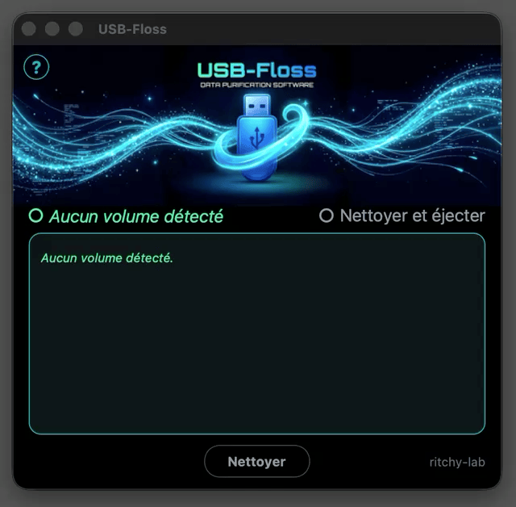

# USB-Floss

🇫🇷 **[Version française](README.md)**

A small utility that cleans up the useless files macOS leaves on a USB drive or
an external disk.

The name comes from "dental floss": the tool cleans the invisible corners of the
drive, where nobody looks. And "FLOSS" also stands for Free/Libre and Open
Source Software — which this project is.

## Download

**With Homebrew:**

```bash
brew install --cask ritchy-lab/tap/usb-floss
```

**Or manually:**

The ready-to-use version (macOS, Apple Silicon) is available in the
[releases](https://github.com/ritchy-lab/USB-Floss/releases/latest): download the
`.zip`, unzip it, then drag **USB-Floss.app** into your Applications folder.

On first launch, macOS warns that the application is not signed with a paid Apple
certificate. To open it anyway: **right-click the app → Open**, then confirm. If
macOS still refuses (macOS 15 and later): **System Settings → Privacy &
Security**, then "Open Anyway" at the bottom of the window.

> **Two interfaces, two repositories.** USB-Floss (this one) is the **simple and
> compact** version. For a more visual version (big button, file list in a
> window), see [USB-Floss Magic](https://github.com/ritchy-lab/USB-Floss-Magic).

## Preview


## In action



## The problem

When you plug a USB drive into a Mac, macOS leaves hidden files on it:

- `.DS_Store` — the Finder's display cache
- `._*` — AppleDouble metadata attached to every file
- `.Spotlight-V100/` — the Spotlight search index
- `.Trashes/` — the macOS trash
- `.fseventsd/` — the file system journal
- `.DocumentRevisions-V100/` — the version history
- `.apdisk`, `.VolumeIcon.icns`, `.localized`, `.AppleDB`, and others

A drive that travels back and forth also picks up files from the other side:
`Thumbs.db` and `Desktop.ini` (Windows), `.Trash-1000` (Linux). USB-Floss
cleans those too.

These files are useless under Windows or Linux. They clutter the drive, pollute
file listings, and sometimes get in the way of a clean copy.

## Two ways to use USB-Floss

### Graphical interface (recommended)

Run the application:

    python3 usb-floss-gui.py

A window opens, detects the plugged-in USB drives automatically, and offers to
clean the one you select. No command to type.

The interface follows the language of your Mac: French on a French system,
English otherwise.

### Command line (for scripts and advanced use)

The `usbfloss.py` script also works on its own, in Terminal.

**Interactive mode:**

    python3 usbfloss.py

The script lists the eligible volumes and asks which one to clean.

**Direct mode (explicit path):**

    python3 usbfloss.py /Volumes/DRIVE_NAME

**Delete with confirmation:**

    python3 usbfloss.py /Volumes/DRIVE_NAME --delete

**Delete without confirmation:**

    python3 usbfloss.py /Volumes/DRIVE_NAME --delete --yes

## Volumes offered automatically

The interactive mode (and the graphical interface) do not offer every mounted
volume. Excluded are:

- the startup disk
- Time Machine volumes
- system volumes (`com.apple.TimeMachine.localsnapshots`)
- volumes larger than 256 GB

This limit exists because USB-Floss is meant for USB drives and small external
disks used as a shuttle between a Mac and a PC. A large storage disk (1 TB or
more) is not meant to be cleaned this way: it is used differently, and the risk
of touching a volume that holds important data is not worth it.

To target a large volume anyway, use the direct mode with its path:

    python3 usbfloss.py /Volumes/BIG_DISK_NAME

## Files protected by macOS

Some folders created by macOS on a USB drive are protected by the system and
cannot be deleted by a normal user:

- `.Spotlight-V100`
- `.Trashes`
- `.fseventsd`
- `.DocumentRevisions-V100`

USB-Floss detects them and lists them, but marks them `(ignored)` and does not
try to delete them. That is normal: macOS will recreate them the next time the
drive is plugged in, and they do not get in the way on a PC.

## Installation

**Requirement:** Python 3.10 or later.

The graphical interface needs two external dependencies:

    pip3 install customtkinter pillow

The command-line script (`usbfloss.py`) has **no** external dependency: it only
uses the Python standard library.

To build the macOS application and its release zip:

    ./build.sh

The script compiles into a temporary folder, cleans the Finder attributes, signs
the bundle, builds the zip and then verifies it by extracting it — that is the
recipe that avoids the "application is damaged" warning.

## How to find a drive's path

**macOS:** drives are mounted under `/Volumes/`. To list them:

    ls /Volumes

**Windows:** the path looks like `D:\` or `E:\`.

**Linux:** `/media/user/DRIVE_NAME` or `/mnt/`.

## Notes

- macOS automatically recreates `.Spotlight-V100` and `.fseventsd` when the drive
  is plugged back into a Mac. It is therefore best to run USB-Floss **just
  before** handing the drive to someone who uses Windows.
- Deleted files do not go to the trash: deletion is permanent. The files involved
  have no value (they are caches), so there is no risk of data loss.

## Support the project

Is this little tool useful to you? You can
[buy me a coffee ☕](https://ko-fi.com/ritchy_lab) — it is the discreet button at
the bottom right of the window.

## Licence

MIT — see the [LICENSE](LICENSE) file.

---

Created by Richard Cogne — 2026
