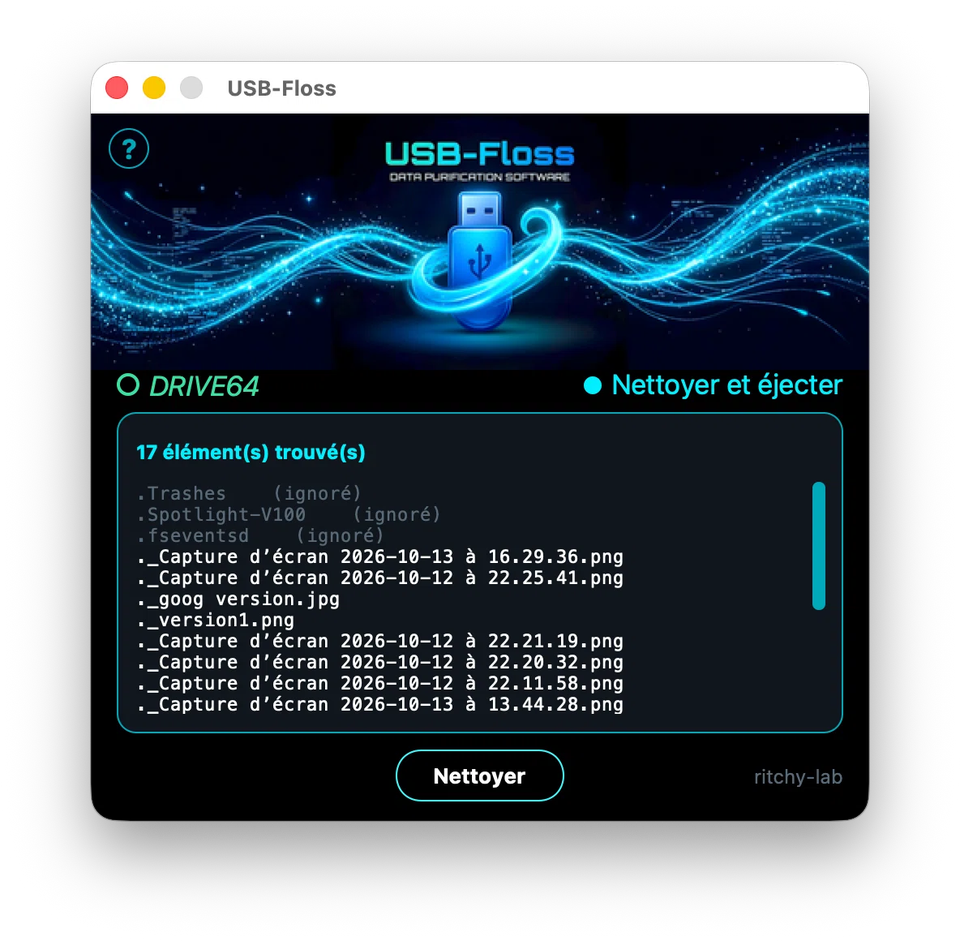

🇬🇧 **[English version](README.en.md)**

# USB-Floss

Un petit utilitaire qui nettoie les fichiers inutiles créés par macOS
sur une clé USB ou un disque externe.

Le nom vient du « fil dentaire » (dental floss) : l'outil nettoie les
recoins invisibles de la clé, là où l'utilisateur normal ne regarde
pas. Et « FLOSS » veut aussi dire Free/Libre and Open Source Software —
ce projet l'est.

## Téléchargement

La version prête à l'emploi (macOS, Apple Silicon) se trouve dans les
[releases](https://github.com/ritchy-lab/USB-Floss/releases/latest) : télécharge le
fichier `.zip`, décompresse-le, puis glisse **USB-Floss.app** dans ton dossier
Applications.

Au premier lancement, macOS prévient que l'application n'est pas signée par un
certificat Apple payant. Pour l'ouvrir quand même : **clic droit sur l'app →
Ouvrir**, puis confirme. Si macOS refuse encore (macOS 15 et suivants) :
**Réglages Système → Confidentialité et sécurité**, puis « Ouvrir quand même »
en bas de la fenêtre.

> **Deux interfaces, deux dépôts.** USB-Floss, ici, est la version **simple et
> compacte**. Pour une version plus visuelle (grand bouton et liste des fichiers
> dans une fenêtre), voir
> [USB-Floss Magic](https://github.com/ritchy-lab/USB-Floss-Magic).

## Aperçu

## Le problème

Quand on branche une clé USB sur un Mac, macOS y laisse des fichiers
cachés invisibles :

- `.DS_Store` — cache d'affichage du Finder
- `._*` — métadonnées AppleDouble attachées à chaque fichier
- `.Spotlight-V100/` — index de recherche Spotlight
- `.Trashes/` — corbeille macOS
- `.fseventsd/` — journal du système de fichiers
- `.DocumentRevisions-V100/` — historique des versions
- `.apdisk`, `.VolumeIcon.icns`, `.localized`, `.AppleDB`, etc.

Une clé qui fait la navette récolte aussi des fichiers venus de l'autre côté :
`Thumbs.db` et `Desktop.ini` (Windows), `.Trash-1000` (Linux). USB-Floss les
nettoie également.

Ces fichiers ne servent à rien sous Windows ou Linux. Ils encombrent
la clé, polluent les listes de fichiers, et parfois empêchent une
copie propre.

## Deux façons d'utiliser USB-Floss

### Interface graphique (recommandée pour les utilisateurs)

Lance l'application :

    python3 usb-floss-gui.py

Une fenêtre s'ouvre, détecte automatiquement les clés USB branchées,
et propose de nettoyer celle que tu sélectionnes. Aucune commande à
taper.

### Ligne de commande (pour les scripts et usages avancés)

Le script `usbfloss.py` fonctionne aussi tout seul, en Terminal.

**Mode interactif :**

    python3 usbfloss.py

Le script liste les volumes éligibles et te demande lequel nettoyer.

**Mode direct (chemin précis) :**

    python3 usbfloss.py /Volumes/NOM_DE_LA_CLE

**Suppression avec confirmation :**

    python3 usbfloss.py /Volumes/NOM_DE_LA_CLE --delete

**Suppression sans confirmation :**

    python3 usbfloss.py /Volumes/NOM_DE_LA_CLE --delete --yes

## Volumes proposés automatiquement

Le mode interactif (et l'interface graphique) ne proposent pas tous
les volumes montés. Sont exclus :

- Le disque de démarrage
- Les volumes Time Machine
- Les volumes système (`com.apple.TimeMachine.localsnapshots`)
- Les volumes de plus de 256 Go

Cette limite existe parce qu'USB-Floss est prévu pour les clés USB et
les petits disques externes qui servent de navette entre Mac et PC.
Un gros disque de stockage (1 To ou plus) n'a pas vocation à être
nettoyé de cette façon : il est utilisé différemment, et le risque de
manipuler un volume contenant des données importantes n'en vaut pas
la peine.

Pour cibler malgré tout un gros volume, utilise le mode direct en
indiquant son chemin :

    python3 usbfloss.py /Volumes/NOM_DU_GROS_DISQUE

## Fichiers protégés par macOS

Certains dossiers créés par macOS sur une clé USB sont protégés par
le système et ne peuvent pas être supprimés par un utilisateur normal :

- `.Spotlight-V100`
- `.Trashes`
- `.fseventsd`
- `.DocumentRevisions-V100`

USB-Floss les détecte et les affiche, mais les marque `(ignoré)` et
ne tente pas de les supprimer. C'est normal : macOS les recréera de
toute façon au prochain branchement, et ils ne gênent en rien
l'utilisation de la clé sur un PC.

## Installation

**Prérequis :** Python 3.10 ou supérieur.

Pour l'interface graphique, deux dépendances externes :

    pip3 install customtkinter pillow

Le script en ligne de commande (`usbfloss.py`) n'a **aucune**
dépendance externe : il utilise uniquement la bibliothèque standard
de Python.

Pour construire l'application macOS et son zip de publication :

    ./build.sh

Le script compile dans un dossier temporaire, nettoie les attributs du Finder,
signe le paquet, fabrique le zip puis le vérifie en l'extrayant — c'est la
recette qui évite l'avertissement « application endommagée ».

## Comment retrouver le chemin d'une clé

**macOS** : les clés sont montées dans `/Volumes/`. Pour voir la liste :

    ls /Volumes

**Windows** : le chemin ressemble à `D:\` ou `E:\`.

**Linux** : `/media/utilisateur/NOM_DE_LA_CLE` ou `/mnt/`.

## Notes

- macOS recrée automatiquement `.Spotlight-V100` et `.fseventsd` quand
  la clé est rebranchée sur un Mac. Il est donc conseillé de relancer
  USB-Floss **juste avant** de donner la clé à quelqu'un qui utilise
  Windows.
- Les fichiers supprimés ne sont pas mis à la corbeille : la
  suppression est définitive. Les fichiers concernés n'ayant aucune
  valeur (ce sont des caches), il n'y a pas de risque de perte de
  données.

## Soutenir le projet

Cet utilitaire te sert ou te plaît ? Tu peux
[m'offrir un café ☕](https://ko-fi.com/ritchy_lab) — c'est le bouton discret en
bas à droite de la fenêtre.

## Licence

MIT — voir le fichier [LICENSE](LICENSE).

---

Créé par Richard Cogne — 2026